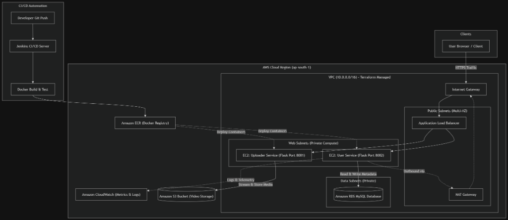

#  EduStream — Cloud-Native Video Streaming Platform


An end-to-end cloud-native video streaming and educational platform engineered with **Python microservices**, automated **Jenkins CI/CD pipelines**, and **Infrastructure as Code (IaC)** deployed across a multi-AZ AWS environment using **Terraform**.

---

##  Key Features

- **Microservices Architecture**: Decoupled user-facing streaming and backend video ingestion into independent containerized services.
- **High Availability & Fault Tolerance**: Multi-Availability Zone deployment on AWS utilizing public, web, and data subnets.
- **Automated CI/CD Delivery**: Declarative Jenkins pipeline automating container builds, Docker image tagging, AWS ECR publishing, and deployment.
- **Infrastructure as Code (IaC)**: Modular Terraform configurations managing VPCs, subnets, route tables, internet/NAT gateways, and compute instances.
- **Responsive Video Streaming Portal**: Dynamic HTML5 video player with course catalog, user authentication (signup/login), and S3 asset delivery.

---

##  System Architecture

<p align="center">
  
</p>


##  Repository Structure

```text
├── edustream-master/
│   ├── Jenkinsfile                # Automated Declarative CI/CD pipeline
│   ├── user-service/              # Streaming portal & user management
│   │   ├── app.py                 # Flask server & route handlers
│   │   ├── Dockerfile             # Container configuration (Port 8082)
│   │   ├── requirements.txt       # Dependencies (Flask, SQLAlchemy, Boto3)
│   │   ├── templates/             # Jinja2 HTML templates (video player, auth, catalog)
│   │   ├── static/                # CSS styling and frontend scripts
│   │   └── videos/                # Video storage mount
│   └── uploader-service/          # Video ingestion microservice
│       ├── app.py                 # File upload processing & S3 integration
│       ├── Dockerfile             # Container configuration (Port 8081)
│       └── requirements.txt       # Dependencies
│
├── edustream-project/             # Infrastructure as Code (Terraform)
│   ├── main.tf                    # VPC, 6 Subnets (2 AZs), Gateways, Route Tables
│   ├── variables.tf               # Region, CIDRs, instance definitions
│   ├── outputs.tf                 # VPC IDs and Subnet output mappings
│   └── terraform.tfvars.example   # Sample variable definitions
│
├── .gitignore                     # Prevents committing tfstate, caches & large media
└── README.md
```

---

## CI/CD Pipeline Flow (Jenkins)

The included `Jenkinsfile` orchestrates the complete lifecycle:
1. **Checkout Code**: Pulls the latest commits from the repository.
2. **Build Microservices**: Builds isolated Docker container images for `user-service` and `uploader-service`.
3. **ECR Authentication**: Logs in to Amazon Elastic Container Registry (ECR).
4. **Push Images**: Tags and pushes production images to AWS ECR.
5. **Continuous Deployment**: Pulls updated images onto application hosts and restarts containers with zero downtime.

---

## Security & Best Practices

- **Zero Credentials in Code**: Database passwords, AWS access keys, and IAM credentials are dynamically injected via environment variables and IAM instance profiles.
- **Isolated Network Layers**: Application containers and RDS databases reside inside private subnets without direct public internet exposure.
- **State Management**: Terraform state files (`*.tfstate`) and sensitive caches are strictly excluded via `.gitignore`.
